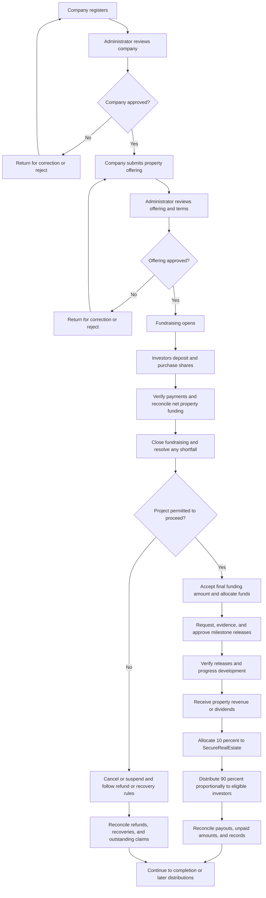
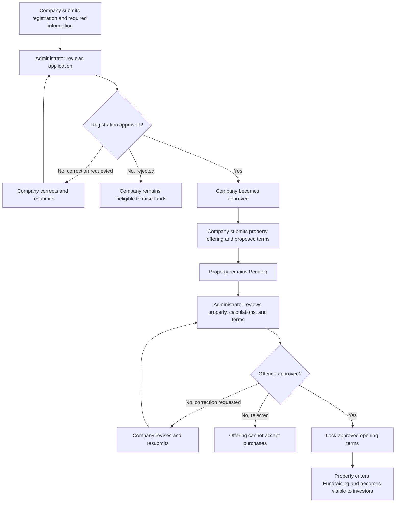
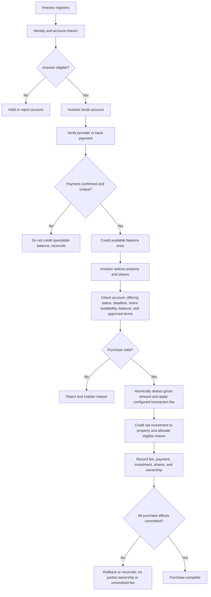
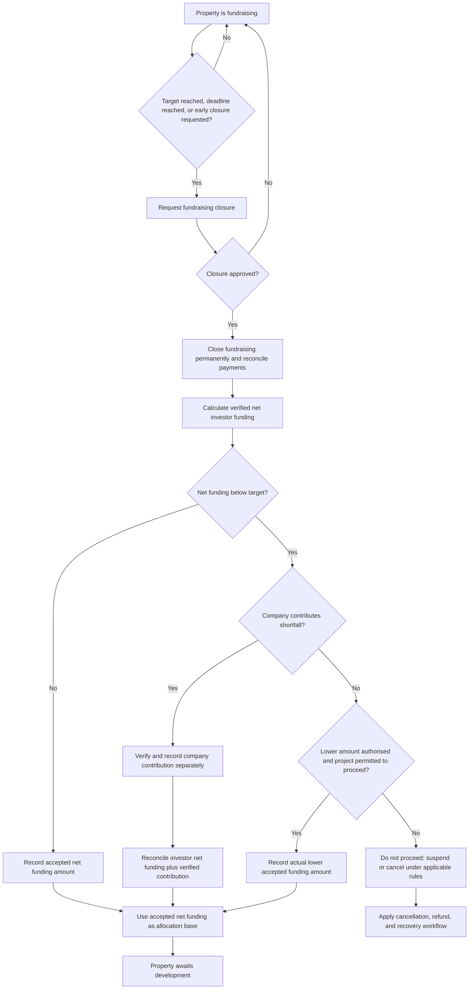
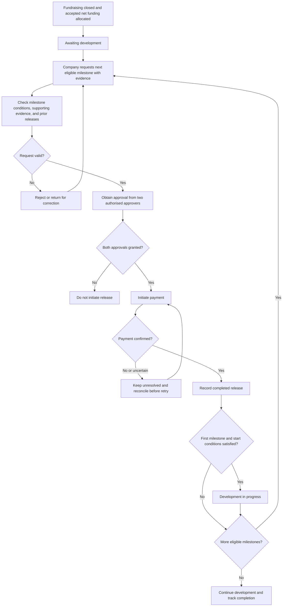
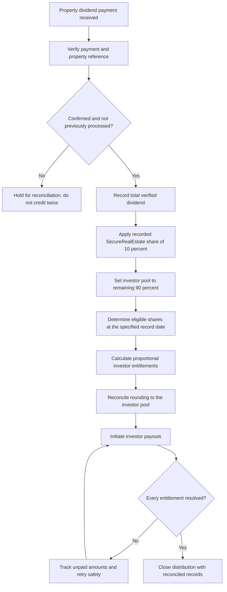
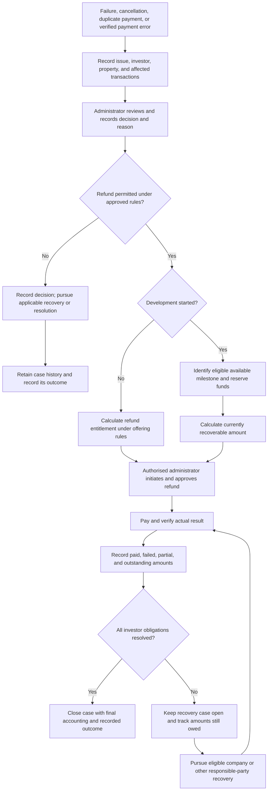
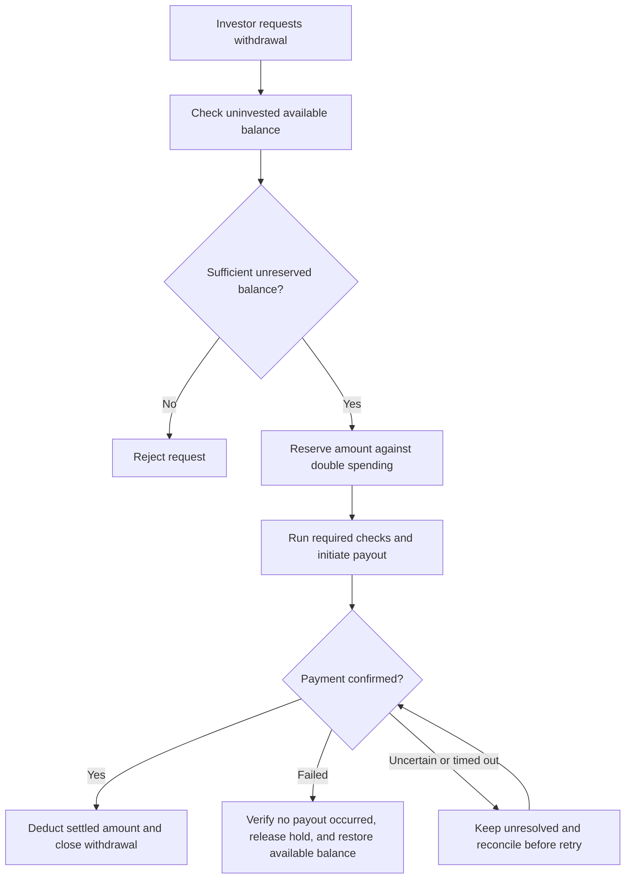
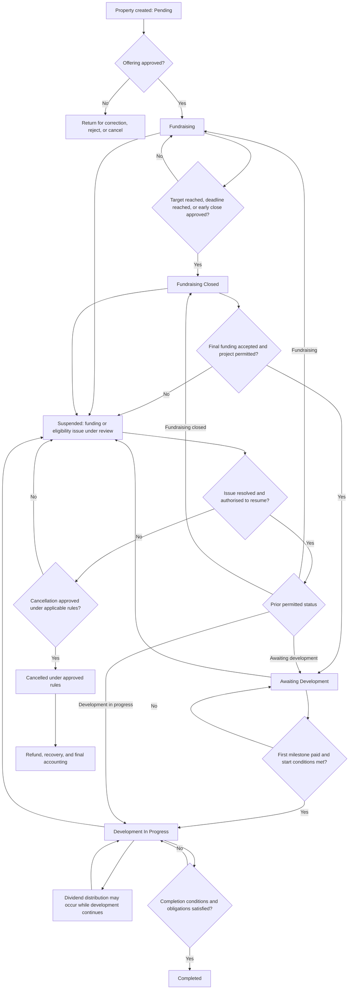

# SecureRealEstate Web2 — Business Workflow and Rules

**Version:** 2  
**Status:** Business workflow specification; not an implementation  
**Purpose:** Define business processes, authorization boundaries, financial rules, branches, and unresolved decisions for SecureRealEstate Web2.

## Table of contents

1. [Purpose and governing principles](#1-purpose-and-governing-principles)
2. [Overall workflow](#2-overall-workflow)
3. [Roles and permissions](#3-roles-and-permissions)
4. [Company onboarding and property listing](#4-company-onboarding-and-property-listing)
5. [Investor onboarding, deposits, and purchases](#5-investor-onboarding-deposits-and-purchases)
6. [Fundraising closure and shortfall branches](#6-fundraising-closure-and-shortfall-branches)
7. [Milestone and reserve rules](#7-milestone-and-reserve-rules)
8. [Dividends and payout reconciliation](#8-dividends-and-payout-reconciliation)
9. [Cancellation, refunds, and recovery](#9-cancellation-refunds-and-recovery)
10. [Withdrawals and share ownership](#10-withdrawals-and-share-ownership)
11. [Property lifecycle and statuses](#11-property-lifecycle-and-statuses)
12. [Authorization and financial-integrity rules](#12-authorization-and-financial-integrity-rules)
13. [Admin configuration and audit history](#13-admin-configuration-and-audit-history)
14. [Unresolved decisions](#14-unresolved-decisions)

## 1. Purpose and governing principles

SecureRealEstate is a Web2 investment application. Companies register and submit property offerings; investors deposit funds and purchase shares; approved funds are released for development milestones; investors may receive property dividends. SecureRealEstate charges a purchase fee and receives a share of property dividends.

The backend is authoritative for calculations, balances, ownership, authorization, financial records, and permitted state transitions. The website displays information and submits requests; it must not be trusted to calculate balances or decide whether an operation is permitted.

The central distinction is between a request, an approval, an initiated payment, and a verified successful payment. None of these states may be silently treated as another. A fundraising target is not money raised, a recorded balance is not necessarily available to spend, and approval is not payment settlement.

### 1.1 Investor purchase fee

The purchase fee is **₦700 per share-purchase transaction**, not per share. It is deducted from the amount paid; it is not an additional charge.

| Calculation | Amount |
| --- | ---: |
| Gross amount paid | ₦100,000 |
| Purchase fee retained by SecureRealEstate | ₦700 |
| Net amount available for share purchase | ₦99,300 |

The fee is separate from the property's net investment. Record the gross payment, the fee actually applied, and the resulting net investment separately. An authorised administrator may change the configured fee under Section 13; a change must not rewrite historical transactions.

If only whole shares are supported, the system must calculate an affordable share quantity and explicitly handle any remainder under an approved rule. Do not silently allocate fractional shares or more shares than are available or paid for. If a purchase fails, it must not leave an unresolved fee charge or partial ownership allocation.

### 1.2 Property dividend split

The dividend split is calculated from the total verified property dividend before investor distributions.

| Recipient | Share of total property dividend |
| --- | ---: |
| SecureRealEstate | 10% |
| Eligible investors collectively | 90% |
| **Total** | **100%** |

For a ₦10 million dividend, SecureRealEstate receives ₦1 million and the investor pool is ₦9 million. An investor holding 20% of all eligible shares receives 20% of that pool, or ₦1.8 million.

The Web2 business rule is the 10% SecureRealEstate share; the former Web3 split involving a protocol and listing platform does not apply. Preserve the actual dividend rate used for each historical distribution.

## 2. Overall workflow

The detailed decisions, checks, exception branches, and authorization rules are in Sections 3–14.

## 3. Roles and permissions

The backend enforces permissions for every operation. Hiding a control in the website is not authorization.

| Role | Permitted actions and boundaries |
| --- | --- |
| Company user | Register a company; after approval, submit its property offerings; request eligible milestone or reserve releases; cannot approve its own requests or execute a release solely by submitting a request. |
| Investor | Complete required identity/account checks; deposit funds; purchase shares when eligible; request withdrawal of available uninvested funds. |
| Authorised administrator | Approve or reject company registrations and property offerings; perform specifically authorised configuration changes; administer refunds under the applicable rules; review and close recovery cases with recorded final accounting. |
| Two distinct authorised approvers | Approve financial milestone and reserve releases. A requester must not be treated as having approved their own request where separation of duties applies. |
| Payment provider or bank | Supplies payment evidence/status. A notification is not trusted as successful until verified and reconciled by the system. |

The exact identity, roles, permission assignment, separation-of-duties, and approval-revocation processes remain to be specified (Section 14).

## 4. Company onboarding and property listing

1. A company cannot create an active fundraising offering until its registration has been approved.
2. An offering must specify the property, share price, total shares available, fundraising target, deadline, proposed milestone allocation rates, reserve percentage, and dividend terms.
3. The property remains **Pending** until an authorised administrator approves the offering. Approval moves it to **Fundraising**. A rejected offering cannot accept investor purchases.
4. Once fundraising opens, the approved share price, share supply, funding target, and deadline are locked. The minimum or target must not be silently changed after opening.
5. A company may request early closure. Once approved, closure is irreversible.
6. Retain approved offering terms as a versioned record. Do not rewrite terms after investors have purchased shares.

The milestone and reserve percentages must be approved before they are treated as final offering terms. The previously listed 35% / 30% / 20% / 15% split is only a proposal (Section 7 and Section 14).

## 5. Investor onboarding, deposits, and purchases

### 5.1 Deposits

- Credit a deposit only after the payment provider or bank confirms receipt.
- A pending, failed, uncertain, or duplicated payment must not create extra spendable balance.
- Give each deposit a unique reference and prevent duplicate crediting.
- Reconcile a timeout or uncertain payment before retrying or crediting it.

### 5.2 Purchase validation and accounting

Before a purchase succeeds, verify that:

- The investor's account is eligible to invest.
- The property is currently fundraising, its deadline has not passed, and it has not closed.
- The requested shares are available.
- The investor has sufficient available balance.
- The share price and ₦700 fee calculation use the approved terms and current authorised fee configuration.
- The payment is verified and has not already been processed.

Perform the purchase as one logically atomic operation: deduct the gross payment from the investor's available funds, record the ₦700 fee, credit the net investment to the offering, allocate the shares, and update ownership. If any required step fails, the system must not leave a partial purchase, partial ownership, or unresolved fee charge.

**Net purchase amount:** `Gross amount paid − ₦700 transaction fee = net amount available for the share purchase`.

For the ₦100,000 example in Section 1, the amount available for shares is ₦99,300. Share-price rounding and any unspent remainder require an approved rule. Do not infer that a remainder is forfeited, refunded, or retained as available balance.

## 6. Fundraising closure and shortfall branches

The fundraising target does not by itself require the company to raise the entire target if the company is authorised and permitted to proceed with a lower accepted amount. Conversely, closing fundraising does not by itself mean the project may proceed.

### 6.1 Example: ₦10 million target and ₦8 million raised

The ₦8 million in this example means **net investor funding credited to the property after purchase fees**, not gross investor payments.

- **Company contribution branch:** The company contributes the missing ₦2 million. Verify the contribution and record it separately from investor money. The resulting accepted net funding amount is ₦10 million.
- **Lower accepted amount branch:** The company does not contribute the shortfall. If closure is authorised and the project is permitted to proceed at this amount, record ₦8 million as the accepted net funding amount and calculate allocations from ₦8 million. Do not represent the original ₦10 million target as raised.
- **Cannot proceed branch:** If the company cannot proceed at the amount raised and no permitted shortfall path is authorised, do not advance to development. Suspend or cancel and apply the relevant refund/recovery rules.

In all branches, preserve the original target in offering history and record verified investor net funding, verified company contributions, and the accepted final net funding amount separately. Milestone amounts are calculated from the accepted net property-funding amount, not automatically from the target or gross investor payments.

The permitted lower amount, any minimum threshold, required closure authority, and how a company contribution affects investor expectations remain unresolved. Until those rules are approved, do not assume a shortfall branch is automatically available.

## 7. Milestone and reserve rules

After fundraising closes and the final net funding amount is accepted, calculate each allocation from that accepted amount using the approved percentages. A company contribution, if accepted, is separately recorded but included in the accepted net property-funding base used for allocation.

### 7.1 Proposed allocation example — not approved

The following split is retained from the earlier workflow only as a **proposal awaiting confirmation**. The percentages must not be treated as final configuration or used to open an offering until approved.

| Proposed allocation | Proposed percentage | Example on ₦8 million accepted net funding |
| --- | ---: | ---: |
| Milestone 1 | 35% | ₦2,800,000 |
| Milestone 2 | 30% | ₦2,400,000 |
| Milestone 3 | 20% | ₦1,600,000 |
| Restricted reserve | 15% | ₦1,200,000 |
| **Total** | **100%** | **₦8,000,000** |

These example amounts are arithmetic illustrations of the proposed percentages, not approval of those percentages. The accepted funding base must be reconciled at the currency's approved precision so that rounding neither creates nor loses money.

### 7.2 Milestone release process

1. Allocation percentages are fixed for each offering once fundraising opens, after those percentages have been approved.
2. Calculate milestone amounts from the final accepted net funding base, not the original target by default.
3. A company may request a release but may not authorise or execute its own payment merely by requesting it.
4. Each milestone request requires the specified evidence, such as invoices, inspection reports, or other approved proof.
5. Each milestone release requires approval from two authorised approvers.
6. Verify the actual payment result before marking a milestone as paid.
7. Reconcile a failed or uncertain payment before another attempt to prevent duplicate releases.
8. Milestone 2 cannot be released before Milestone 1 is successfully released and its conditions are met. Milestone 3 follows the same dependency on Milestone 2.
9. The property enters **Development In Progress** only after the first milestone release succeeds and development-start conditions are satisfied—not merely when a release is requested or approved.

### 7.3 Restricted reserve and emergency releases

The reserve is restricted money, not an ordinary milestone or freely withdrawable company funds. The earlier workflow proposed 15% of accepted net funding; that percentage remains unapproved and must not be assumed final.

- Reserve funds are unavailable for ordinary development spending.
- A company may request a reserve release only for a predefined emergency and must provide supporting evidence.
- An authorised administrator reviews the emergency request; a reserve financial release requires two authorised approvers.
- The amount must be within the permitted per-event cap and available reserve balance.
- Record the reason, evidence references, approvers, amount, and actual payment result.
- Reject requests that are not eligible emergencies or exceed the approved cap or available reserve.
- Configure emergency categories and the per-event cap before fundraising opens.
- If unused, the reserve remains restricted until approved completion or closure rules determine its treatment. It must not automatically become company profit.

## 8. Dividends and payout reconciliation

1. A dividend counts as received only after payment is verified. Never process the same incoming dividend twice.
2. SecureRealEstate receives 10% of the total verified property dividend; eligible investors collectively receive the remaining 90%.
3. Determine eligible shares consistently using the offering's specified record date. Preserve the eligible-share total used for that distribution.
4. Investor entitlements are proportional to eligible shares and must reconcile to the investor pool, including any rounding remainder.
5. Automatically initiate payments according to the approved distribution process.
6. Failed payments remain recorded as unpaid obligations. They are neither marked paid nor silently included in another distribution.
7. Close a distribution only when every entitlement has a recorded accounting outcome, including any amount that remains unpaid.
8. Record the actual dividend rate applied; changes must not rewrite historical distributions.

## 9. Cancellation, refunds, and recovery

A project may fail before development, during a milestone, after all milestones are released, or during dividend operations. Each case must preserve the complete financial history.

### 9.1 Before development starts

- If the property is cancelled before development, investors are entitled to a full refund under the approved offering rules.
- Calculate each investor's refundable investment from ownership and financial records.
- Record the ₦700 purchase fee separately. Whether it is included in a cancellation refund is unresolved and must be specified in the offering rules before implementation.

### 9.2 After development starts

- Do not automatically promise a full refund.
- First identify milestone and reserve funds that remain available and are permitted to be used for recovery.
- Calculate and process refunds from eligible recoverable funds.
- Record outstanding investor claims and amounts still to be recovered from the company or other responsible parties.
- Keep the case open while recovery continues. Close it only when recovery is complete or an authorised person formally closes it with a recorded reason and final accounting.
- If recovered funds are insufficient to meet investor principal, record the shortfall and recovery status. The method for allocating partial recovery is unresolved (Section 14).

### 9.3 Refund authority and ownership history

- An authorised administrator initiates and approves refunds under the current rule. This is separate from ordinary milestone releases, which require two authorised approvers.
- Each refund references the original investor, property, purchase or claim, reason, and actual payment result.
- A duplicate payment or verified payment error may also trigger a refund even when the property has not failed.
- A refund, partial recovery, or loss must not silently rewrite whether shares were purchased or erase the original purchase record.

## 10. Withdrawals and share ownership

- Investors may withdraw money in their account that has not been invested.
- No SecureRealEstate platform withdrawal percentage fee applies. Record any third-party charge separately.
- Only uninvested, available funds may be withdrawn. Funds reserved for another withdrawal or purchase cannot be spent again.
- Reconcile an uncertain or timed-out payout before retrying. Restore the balance only after confirming that no payout occurred.
- Share transfers between users are disabled in the initial release. Any legally required exceptional ownership change must use a separate controlled administrative workflow.
- Share ownership must reconcile to the purchase history. A later refund, recovery, or loss must not silently rewrite the historical fact of purchase.
- Shares sold cannot exceed the approved supply. Investor ownership must be calculated from recorded share purchases and any separately authorised ownership corrections.

## 11. Property lifecycle and statuses

Property status describes its lifecycle; it is not a substitute for the status of an individual milestone, payment, refund, or dividend distribution.

| Status | Meaning |
| --- | --- |
| **Pending** | Property has been created but has not been approved for fundraising. |
| **Fundraising** | Eligible investors may purchase available shares under the approved offering. |
| **Fundraising Closed** | No further purchases are accepted; final funding is being confirmed or recorded. |
| **Awaiting Development** | Fundraising is closed, the final funding base is accepted and allocated, and development has not started. |
| **Development In Progress** | The first milestone was successfully released and development has started. |
| **Dividend Distribution** | A distribution is being processed; development need not have ended. Track this on a separate distribution record/status rather than permanently replacing the development status. |
| **Suspended** | Normal operations are paused while an issue is reviewed or resolved. |
| **Cancelled** | The offering or project was cancelled under the approved rules. |
| **Completed** | Defined project completion conditions are satisfied and remaining obligations have been handled. |

A property can remain **Development In Progress** when no dividend is being processed. Dividend processing can occur while development continues. Transition from a suspended state must be authorised and recorded; transition to cancellation follows the applicable refund and recovery rules.

## 12. Authorization and financial-integrity rules

### 12.1 Action authorization

| Action | Required authority |
| --- | --- |
| Register a company | Company user |
| Approve a company | Authorised administrator |
| Create a property offering | Approved company |
| Approve an offering | Authorised administrator |
| Purchase shares | Eligible investor, subject to all purchase checks |
| Request a milestone release | Approved company |
| Approve a milestone release | Two authorised approvers |
| Request reserve funds | Approved company, for an eligible emergency |
| Approve a reserve release | Required authorised approvers; financial release requires two |
| Initiate and approve a refund | Authorised administrator under the current rule |
| Withdraw uninvested balance | Eligible investor, subject to balance and payment checks |
| Change purchase-fee configuration | Specifically authorised administrator; audit record required |
| Close a failed-project recovery case | Authorised administrator, with reason and final accounting |

### 12.2 Financial-integrity requirements

1. **Traceable movement:** Every deposit, purchase, fee, company contribution, release, dividend, refund, recovery, withdrawal, and correction has a unique reference.
2. **No double spending:** One balance cannot fund two purchases or payouts. Concurrent requests must not over-allocate money or shares.
3. **No invented money:** A balance changes only through a verified financial event or an authorised accounting correction.
4. **No silent correction:** Preserve the original transaction and record who corrected it, why, and when.
5. **No premature success:** A request or approval is not a successful payment.
6. **No duplicate processing:** Retries, repeated provider notifications, and network timeouts must not create duplicate purchases, releases, fees, or dividends.
7. **Full reconciliation:** Account for every amount, including gross payments, the actual fee, net investment, company contributions, allocations, unpaid amounts, and rounding.
8. **Ownership reconciliation:** Shares sold cannot exceed approved supply; investor ownership must match purchase history.
9. **Fixed offering terms:** Do not silently alter the approved share price, share supply, target, deadline, or approved milestone allocation rates after fundraising opens.
10. **Retained history:** Cancelling or completing a property does not delete its transactions, ownership records, or recovery history.
11. **Backend enforcement:** The backend performs authorization and financial validation; user-interface controls are not security boundaries.

## 13. Admin configuration and audit history

Some values are configurable business parameters. A configuration change applies only as permitted by an authorised decision; it must never silently rewrite historical transactions or distributions.

| Setting | Current value or status | Change and history rule |
| --- | --- | --- |
| Investor purchase fee | ₦700 per share-purchase transaction | Specifically authorised administrator may change it. Record old value, new value, administrator, timestamp, and reason. Store the actual fee applied to every purchase. |
| SecureRealEstate dividend share | 10% of total property dividend | Record the actual rate applied to each distribution. Whether a change applies to existing offerings is unresolved. |
| Investor dividend pool | 90% of total property dividend | Remaining share after the 10% SecureRealEstate allocation; reconcile to eligible investor entitlements. |
| Milestone 1 | 35% proposed; awaiting confirmation | Must be approved before use and fixed for an offering after fundraising opens. |
| Milestone 2 | 30% proposed; awaiting confirmation | Must be approved before use and fixed for an offering after fundraising opens. |
| Milestone 3 | 20% proposed; awaiting confirmation | Must be approved before use and fixed for an offering after fundraising opens. |
| Restricted reserve | 15% proposed; awaiting confirmation | Must be approved before use and fixed for an offering after fundraising opens. Unused-reserve treatment remains unresolved. |
| Fundraising deadline | Offering-specific | Fixed after fundraising opens. |
| Share price and supply | Offering-specific | Approved values are fixed after fundraising opens. |
| Funding target | Offering-specific | The original target remains in history; any accepted lower final amount is recorded separately and requires an approved shortfall rule. |
| Emergency categories and reserve cap | Not yet confirmed | Define and configure before fundraising opens. |

For each purchase-fee change, retain the old and new amounts, authorised administrator identity, timestamp, and reason. For each purchase, retain the fee actually charged, so future configuration changes cannot change history.

The proposed allocation is 35% + 30% + 20% + 15% = 100%, but this arithmetic does not approve the split. Until confirmed, it is illustrative only.

## 14. Unresolved decisions

Do not invent or silently approve any item in this section. Resolve the relevant decisions before implementing the affected workflow or opening an offering that depends on them.

1. **Share-purchase remainder:** Are fractional shares allowed? If only whole shares are allowed, how is any unspent amount handled—retained as available investor balance, refunded, or dealt with by another approved rule?
2. **Minimum purchase amount:** Define the minimum gross payment and the purchase outcome when the configured ₦700 fee equals or exceeds the gross payment.
3. **Purchase-fee refunds:** Is the ₦700 fee refundable on a pre-development cancellation, failed payment, duplicate payment, or other refund? The fee must still be recorded separately, and a failed purchase must not leave an unresolved charge.
4. **Milestone split:** Confirm or replace the proposed 35% / 30% / 20% / 15% split. The values are not approved merely because they appeared in the earlier workflow.
5. **Reserve:** Confirm the reserve percentage, eligible emergency categories, approval/separation-of-duties rules, per-event cap, and treatment of unused reserve at completion or cancellation.
6. **Fundraising shortfall:** Define any minimum amount, who authorises a company contribution or lower accepted amount, when a project may proceed below target, and when closure must instead lead to suspension, cancellation, or refunds.
7. **Refunds and recovery:** Define refund timing, recovery priority, use of remaining milestone/reserve funds, allocation of partial recoveries, company or third-party recovery, and authority to formally close an unresolved case. Specify whether fee refunds differ by case.
8. **Dividend eligibility:** Define eligible investors and shares, the distribution record date, and how eligibility changes after a cancellation, refund, or exceptional ownership correction.
9. **Dividend-rate changes:** Define who can change the 10% rate and whether a new rate applies only to future offerings or also to future distributions for existing offerings. Historical distributions must retain their actual applied rate.
10. **Payment reconciliation:** Select the payment provider and define authoritative settlement evidence, notification authentication, retries, timeouts, chargebacks, duplicate detection, and the exact success signal.
11. **Currency and rounding:** Define storage precision, rounding methods, share-price remainder treatment, and allocation of rounding differences in milestone allocations and investor dividend payouts.
12. **Withdrawals and third-party charges:** Define any withdrawal limits, processing timeline, payout failure handling beyond restoring funds after confirming no payout occurred, and how external charges are disclosed and recorded.
13. **Roles and approvals:** Define identity verification, administrator and company roles, permission assignment, two-person separation of duties, approval revocation, and emergency access controls.
14. **Lifecycle details:** Define minimum fundraising conditions, closure/reopening restrictions, development completion criteria, and which issue-resolution decisions permit resumption from suspension.

### 14.1 Governing reminder

SecureRealEstate must not confuse a request with an approval, an approval with a successful payment, a fundraising target with money actually raised, or a recorded balance with money actually available. The financial mathematics, authorization, state transitions, and auditability described here remain mandatory while unresolved business choices are awaiting approval.
